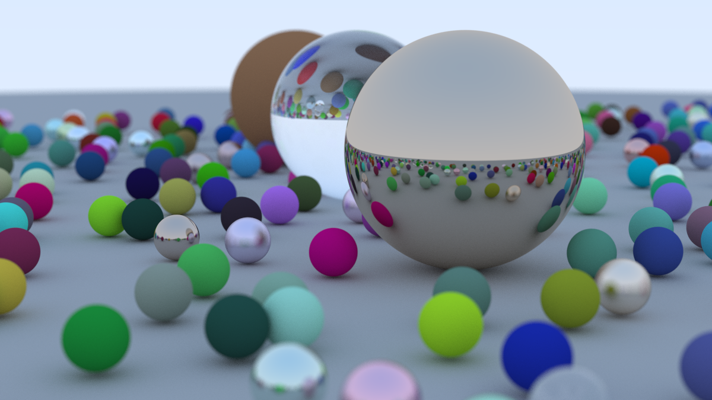

# raytracer-cpp



A dependency-free CPU path tracer written from scratch in C++23. Renders scenes directly to ASCII PPM (`P3`) using only the C++ standard library, paired with a standard-library Python script to export PNGs without external tools.

### Project Structure

```text
raytracer-cpp/
├── main.cpp           # Scene setup and camera configuration
├── rtweekend.h        # Shared constants, utilities, and thread-local RNG
├── vec3.h             # 3D vector, point, and color math
├── ray.h              # Ray origin, direction, and parametric evaluation
├── color.h            # Gamma-2 correction, clamping, and PPM pixel output
├── hittable.h         # Hit record and abstract geometry interface
├── hittable_list.h    # Scene container with closest-hit traversal
├── sphere.h           # Ray-sphere intersection
├── material.h         # Lambertian, metal, and dielectric scattering models
├── camera.h           # Viewport projection, path tracing loop, and thread pool
├── ppm_to_png.py      # Standard-library ASCII PPM (P3) to PNG converter
└── render.png         # Final rendered output
```

### Features

- **Math Core (`vec3.h`, `ray.h`)**: 3D vector/point arithmetic, dot and cross products, specular reflection, Snell's law refraction, and rejection sampling for unit spheres and disks.
- **Scene Geometry (`hittable.h`, `hittable_list.h`, `sphere.h`)**: Polymorphic `hittable` interface with closest-hit interval tracking and consistent outward/inward surface normal orientation.
- **Materials (`material.h`)**:
  - **Lambertian**: True Lambertian diffuse scattering with near-zero scatter vector guards.
  - **Metal**: Specular reflection with configurable fuzz/roughness.
  - **Dielectric**: Refractive glass with total internal reflection and Schlick's Fresnel approximation.
- **Camera & Sampling (`camera.h`, `color.h`)**:
  - Configurable camera position (`lookfrom`, `lookat`, `vup`) and vertical field of view (`vfov`).
  - Thin-lens depth of field (`defocus_angle`, `focus_dist`).
  - Multi-sample jittered antialiasing, configurable max bounce depth, shadow acne mitigation (`t_min = 0.001`), and gamma-2 color correction.
- **Multithreading**: Dynamic scanline scheduling via `std::atomic` and `std::thread`, thread-local `std::mt19937` RNG, and an in-memory framebuffer.
- **Zero-Dependency PNG Export (`ppm_to_png.py`)**: Converts ASCII `P3` PPM output (including UTF-16 output from Windows PowerShell) directly to compressed PNG using Python's `zlib` and `struct` modules.

### Continuing the Project

#### 1. Clone, Build & Run

```bash
git clone https://github.com/Base21rizz/raytracer-cpp.git
cd raytracer-cpp
```

**Linux / macOS:**
```bash
g++ -std=c++23 -O3 -pthread main.cpp -o rt
./rt > image.ppm
python3 ppm_to_png.py
```

**Windows (PowerShell):**
```powershell
g++ -std=c++23 -O3 -pthread main.cpp -o rt.exe
./rt.exe > image.ppm
python ppm_to_png.py
```

#### 2. Fast Iteration Workflow

The default settings in `main.cpp` (`1200x675`, `500` samples/pixel, `50` max depth, ~480 spheres) take ~443s on 12 CPU threads due to linear ray-object intersection. Before making changes:

1. Lower `cam.image_width` (e.g., `400`) and `cam.samples_per_pixel` (e.g., `20–50`) in `main.cpp` for fast test renders.
2. Create a feature branch (`git checkout -b feat/<feature-name>`).
3. Implement one feature at a time, compile with `-O3 -Wall -Wextra`, and verify `render.png`.
4. Restore high-res settings only for final showcase renders.

#### 3. Export Codebase Context for AI Assistance

Bundle all source files into a single file to attach or paste into an AI coding assistant:

**PowerShell:**
```powershell
Get-ChildItem -Include *.h,*.cpp -Recurse | ForEach-Object { "=== $($_.Name) ==="; Get-Content $_ } | Set-Content context.txt
```

**Bash (Linux / macOS):**
```bash
for f in *.h *.cpp; do echo "=== $f ==="; cat "$f"; echo ""; done > context.txt
```

#### 4. AI Continuation Prompt

Attach `context.txt` and paste the following prompt to continue development cleanly:

```text
I am continuing development on a scratch-built, dependency-free C++23 CPU path tracer (`raytracer-cpp`). I have attached the full codebase (`context.txt`).

Current architecture & specs:
- Language/Toolchain: C++23 (GCC / MinGW-w64), standard library only (zero external C++ dependencies), paired with a stdlib-only Python script (`ppm_to_png.py`) for PNG export.
- Core files: `rtweekend.h`, `vec3.h`, `ray.h`, `color.h`, `hittable.h`, `hittable_list.h`, `sphere.h`, `material.h`, `camera.h`, `main.cpp`.
- Implemented features: Lambertian/Metal/Dielectric materials, positionable camera with FOV and thin-lens depth of field, multi-sample jittered AA, gamma-2 correction, and dynamic scanline multithreading (`std::thread`, `std::atomic`, `thread_local std::mt19937`).
- Baseline performance: 1200x675, 500 spp, 50 max depth, ~480 spheres in ~443s on 12 CPU threads (linear scene scan, no acceleration structure).

Constraints for all changes:
1. Keep the engine 100% dependency-free (C++23 standard library only).
2. Preserve thread safety (`thread_local` RNG, lock-free scanline dispatch, immutable shared scene state during render).
3. Follow the existing header/coding style and keep changes modular and incremental.
4. Explain the math/algorithm briefly before giving exact file-by-file code updates and the build command.

Next feature I want to implement: [INSERT FEATURE HERE — e.g., AABB + BVH acceleration, textures, emissive lights + Cornell Box, or triangle meshes]
```

#### 5. Recommended Next Milestones

- **BVH Acceleration**: Add Axis-Aligned Bounding Boxes (`aabb.h`) and a Bounding Volume Hierarchy (`bvh.h`) to reduce ray-scene intersection from $O(N)$ to $O(\log N)$.
- **Lighting & Emissives**: Add diffuse light materials, configurable background color, and quad primitives to render a Cornell Box.
- **Textures & Motion Blur**: Add UV coordinates, checker/Perlin noise textures, and time-dependent rays for moving spheres.
- **Mesh Support**: Implement Möller–Trumbore ray-triangle intersection and a minimal `.obj` loader.

> References: Peter Shirley, Trevor David Black, Steve Hollasch — Ray Tracing in One Weekend
